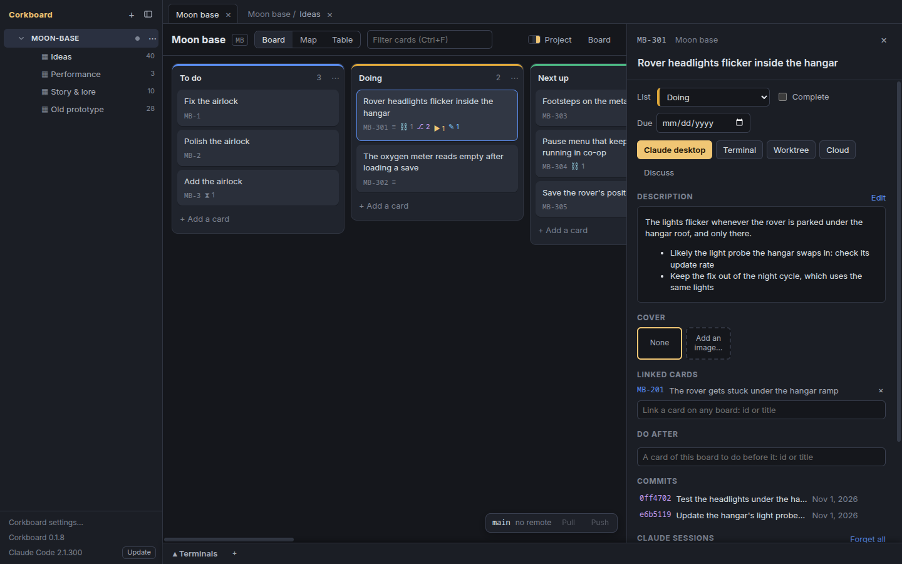
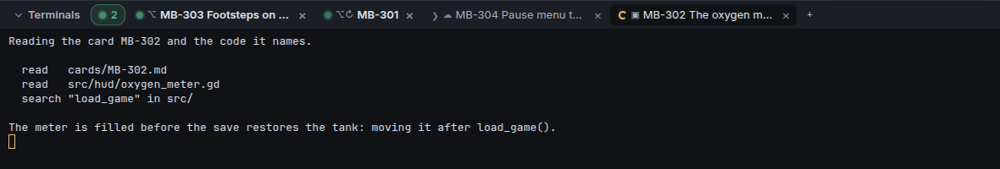

# Tackling with Claude

A card is a prompt waiting to be sent. Corkboard starts Claude Code sessions from cards, lists and selections, keeps them in terminal tabs that show whose turn it is, records them on their cards so they can be resumed, and shows on each card the commits that name it.

## Tackle

From a card: *Tackle locally*, *In a worktree* or *Claude Cloud*. From a list header (*Tackle all*) or a selection of two or more (Ctrl-click cards, Shift-click a range; with a card open in the drawer, the selection starts from it): one local session for all of them in order, one session per card in parallel (each in its own worktree), or one cloud session. A card's `after:` (the cards of its board to be done before it, set in a discussion or by hand) orders them: one session works every card after the ones it waits on, and *one per card* keeps the cards an order joins in one session, in that order, so only work that doesn't wait on other work runs side by side. The confirmation says which cards share a session. Cards waiting on each other in a loop don't start. A card waiting on one that isn't done and isn't in the tackle (in any tackle, a single card's too) asks first, and starts anyway once you say so. Every session runs in the embedded terminal panel (Ctrl+`), is recorded on its cards (`sessions:`), and can be resumed from the card; the card face shows a ▶ badge for them until the card is done (in the board's done list, or marked complete), the drawer keeps them after.

### The tackle buttons

| Button | Runs |
| --- | --- |
| Claude desktop | opens `claude://code/new?q=<prompt>&folder=<code repo>`: a new Code session in the Claude desktop app, in the code repo once you trust it (the app asks each time), the prompt filled in (a prompt over 14,000 characters goes in a temporary file the link points to). The link can't pick a branch, and a draft sent with its branch blank starts with no folder: pick the branch before sending. The prompt names the code repo, and a session that started anywhere else moves itself there with the desktop app's `change_directory` tool (you approve the folder), or stops and says so |
| Terminal | `claude --add-dir <board repo> --mcp-config <file> --plugin-dir <mod> -n "<ID> <title>" --session-id <uuid> "<prompt>"` in the board's code repo (`--add-dir` and `--mcp-config` first: each takes every argument up to the next option, and placed last `--add-dir` swallowed the prompt). `--mcp-config` hands the session the app's [MCP server](#the-apps-mcp-server) and `--plugin-dir` the [companion mod](#the-companion-mod); each is left out when there is none to give |
| In a worktree | the same plus `-w card-<id>` (Claude Code makes `.claude/worktrees/card-<id>` on branch `worktree-card-<id>`); in a work project `-w <Jira key>`, or a slug of the title without one |
| Claude Cloud | `claude --cloud "<prompt>"`: a claude.ai/code session on GitHub's copy of the current branch (push first); the URL it prints is saved on the card |

### The prompt

The prompt carries the card's title, description and linked cards, the path of its file (with a pointer to the board repo's `CLAUDE.md`, when it has one), and the rules: put a `Card: <ID>` trailer on every commit (in a work project: name the Jira key and write no card id into the code repo), move the card to the board's done list when it is verified (`flow.done` in the board settings; nothing is said when it is unset), and never commit in the board repo. A terminal or worktree session that has the app's MCP server is told to change cards with its tools and never by editing their files; every other session (Claude desktop, the cloud, a prompt copied with *Copy prompt*) edits the card file, as the board repo's `CLAUDE.md` describes. Board settings also hold *Prompt notes*, appended to every prompt, and the list a tackled card moves to (`flow.doing`).

### The app's MCP server

While Corkboard runs, it serves an MCP server to the sessions it starts in a terminal or a worktree (a resumed one gets it again). Through it a session reads the boards and changes cards the way the window does: the app checks the change (a list that exists, a link to a card that exists, an `after` that names cards of the same board and makes no loop, a date, a Jira key) and stamps `updated:` from its own clock, which decides a sync conflict; a session editing the file has to keep the format and look the time up. The tools: `list_boards` (projects, boards with their keys, lists and flow), `get_card` (by id, on any board), `search_cards` (by id or title, board, list), `move_card` (to a list id, or the board's flow `doing` / `done`), `update_card` (title, description, labels, links, `after`, due, complete, `jira`), `create_card`, `archive_card` (cards are never deleted), `link_cards` and `show_card` (brings a card up in the window, its board in front and its drawer open, and changes nothing). Each answers with the card as it now is. None of them commits, syncs or touches a code repo: the app commits the board repo as it does any change, and a work project's sessions get the same tools.

The server is MCP over HTTP at `http://127.0.0.1:47823/mcp` for the installed app and `http://127.0.0.1:47824/mcp` for one run from the source (`npm run dev`, `npm start`), so the two run side by side. It listens on this machine only, and every request needs the token the app made once and keeps in its user data (`mcp-token`); a request naming another host, or from a web page's origin, is turned away. When the port is taken the app uses a free one: the sessions it starts are told that one. A session gets the URL and token in a file of the user data (`mcp-config-<port>.json`, readable by you only), so the token is in no command line. A cloud session can't reach this machine, and a Claude desktop session or one you start yourself doesn't get the server yet.

### The companion mod

A session started in a terminal or a worktree is also handed Corkboard's companion mod (`--plugin-dir`), a small Claude Code plugin that ships with the app. It knows which cards the session was started for: the app puts them in the terminal's environment, and the session says so in its own window. A resumed session gets the mod and the same environment again, so it knows its cards as the first one did. Nothing is lost when it doesn't load — Claude Code's plugin API is early access, and a session without the mod is the session as it was.

What the terminal holds, for the mod and for anything else you run in that tab:

| Variable | What |
| --- | --- |
| `CORKBOARD_CARDS` | the session's card ids, comma-separated (`CORK-142,CORK-101`), in the order the tackle works them |
| `CORKBOARD_BOARD` | the board's key, `<project id>:<path>` — what the MCP tools take |
| `CORKBOARD_BOARD_DIR` | that board's folder on this machine, which holds its `cards/` |
| `CORKBOARD_CARD_PREFIX` | the prefix every card id of the board carries (`CORK`) |
| `CORKBOARD_WORK` | `1` in a [work project](work-mode.md), `0` otherwise |

**The card pane.** Above the prompt the mod draws the card the session was started for — its id, its list and its title, the first lines of its description, the cards it links to and the commits that name it (in a [work project](work-mode.md), its Jira key and the commits naming that) — and a session of several cards shows them all. It reads the cards through the app's board tools, over the MCP connection the session already has, and again every few seconds, so a card moved or edited in the window changes in the pane too. Two buttons sit under it: *Move to Done* puts the session's cards in the board's done list (all of them: the cards a tackle put in one session are meant to be finished together), and *Open in Corkboard* brings the first one up in the window, its board in front and its drawer open.

With Corkboard closed there is no server to ask: the pane reads the card file in the board repo instead, says so, and drops the buttons. It never writes a card file itself — `updated:` is the app's to stamp, and it decides which side of a sync conflict a card keeps.

**The `/card` command.** `/corkboard-mod:card` in a session the mod loaded in (Claude Code puts a plugin's name in front of its commands, so that is the whole name; the terminal completes it from `/co`):

| Command | What it does |
| --- | --- |
| `/corkboard-mod:card` | names the session's cards and draws the pane again |
| `/corkboard-mod:card done` | moves every card of the session to the board's done list, and says what moved |
| `/corkboard-mod:card note <text>` | appends the line to the description of every card of the session |
| `/corkboard-mod:card new <title> [--list <id>]` | makes a card on the session's board, in the list named or the board's first |

You run them yourself: the mod answers each one and drops the prompt, so none of them spends a model turn or reaches Claude at all. Each goes through the app's board tools, which check the change and stamp `updated:`; with Corkboard closed there is nothing to write through, and a command that would write says so and writes nothing — the mod never edits a card file behind the app's back. A session of several cards has them all moved or noted on together, since the cards a tackle put in one session are meant to be finished together, and being asked which would be a prompt in the middle of your own command.

**The commit guard.** The mod also reads the Bash calls the session makes, and refuses the ones that break the card-id rule its prompt was given, so the rule holds mechanically instead of by good behaviour. In a personal project a `git commit` of the session's own repo must carry a `Card: <ID>` trailer naming one of its cards; without one the call never reaches git and the reason says which trailer to add, so Claude adds it and commits again. In a [work project](work-mode.md) it is the other way round: a commit message, a branch or tag name, or a `gh pr create` / `gh pr edit` title or body that holds any card id of the board is refused, and the reason names the Jira key to use instead — a card id pushed to a client's repo can't be taken back, which is why it refuses rather than warns.

It is a guard against mistakes, not a wall: it reads only the session's own calls, only in the code repo the session runs in (a command on another repo, and anything in the board repo, are left alone), and what it cannot read it lets through — a message from a `$(…)`, a file it cannot open, or a commit whose message git writes itself (a merge, a revert, a `rebase --continue`, an `--amend` that keeps the message it has).

A Claude desktop session gets neither the mod nor the MCP server: a `claude://` link carries no arguments. A cloud session can't reach this machine either; its tab still holds the variables above.

### The desktop app's links

The desktop app's links were read from the app (2.19675): `claude://code/new?q=&folder=` (one folder: given two, the app ignores both and opens the last folder it used; no branch, which Anthropic's page on the link confirms: it takes `q`, `folder` and `file`), `claude://code/continue?session=local_<id>` (one of its sessions) and `claude://resume?session=<uuid>` (imports a CLI session); only the first is documented. After a desktop tackle the app watches the desktop app's own session index (`~/.config/Claude/claude-code-sessions/**/local_*.json`: its id, the CLI session id, the folder, the start time) for a session whose transcript starts with the prompt, in whatever folder it started (the index keeps a scratch workspace's after the session moves), for up to 30 minutes, and puts both ids on the card: its *Open* button reopens it in the desktop app. A terminal session's *Desktop* button imports it into the desktop app. If an app update moves these, a desktop tackle still opens the session; only the link back to the card is lost.

## Cards ↔ code

A board names its code repo (`codeRepo`, inherited by child boards). Commits there that carry a `Card: RS-886` trailer show on the card, on any branch. Click one in the drawer for the files it touched; *Copy* (on hover) or its right-click menu copies its SHA. In a [work project](work-mode.md) the card shows the commits that name its Jira key instead.

A small panel at the board's bottom right shows the code repo of the board in front (each tab's own, as boards can name different ones): its branch, `↑` commits to push and `↓` to pull against its upstream (as of the last fetch: the app fetches when the tab opens and when the window comes back, at most every five minutes, and stops trying after a fetch fails), and how many files are changed and not committed. It follows commits, checkouts and fetches made anywhere, a worktree's included, by watching the repo's git folder. *Push* asks first, naming the branch and the remote; a branch with no upstream goes to `origin` (else the only remote) and takes it as its upstream. *Pull* is fast-forward only: a branch that diverged says so and is left for you to merge or rebase. Neither commits anything, and what goes wrong (a credential, no network) shows as a message. The panel isn't there for a board with no code repo on this machine, or one that isn't a git repo.

## Discuss before tackling

*Discuss* on a card (its drawer, or its menu) and *Discuss / triage* on a list or a selection open one conversation, in Claude desktop or a terminal, that may not implement anything: no code changes, no new files, no commits in the code repo unless you ask in it. Claude reads the cards and the code and talks them through (what's unclear, risks, scope, splitting; for a list: still relevant, ready, to split, merge, move or archive), and once you agree it writes the outcome into the cards themselves (with the app's MCP server in a terminal, in the card files from Claude desktop), which is how a card gets its details before it's tackled. A discussion leaves the cards in their lists and shows as ✎ on the card.

The drawer's *Discuss* opens in a terminal, unless *Discuss opens in* in *Corkboard settings…* says Claude desktop (kept on this machine; on one without the desktop app it stays a terminal). The menus' *Discuss* submenus offer both, the one picked there first.

## Untangle a renumbered card

When a sync renumbers a card (two machines made a card under one id: see [The board repo](board-repo.md#synced-between-machines)), what was written before it may still name the old id and mean either card. *Untangle references*, on the side panel's notice and on the renumbered card's menu, starts a Claude session in a terminal with both cards in its prompt. It reads every mention of the old id on the board (descriptions, `links:`, `after:`), decides from the context which card each means and fixes the ones meaning the renumbered card. In the code repo it finds the commits whose `Card:` trailer names the old id and the branches named after it: an unpushed one that belongs to the renumbered card it offers to reword before the push; a pushed one stays, and is named on the card. It asks before anything it isn't sure of. A work project's code repo names no card id, so there the session leaves it alone. The card stays in its list.

## Terminal tabs show what Claude is doing

Each tab's icon: a spinner while Claude works, a green dot when it's your turn (Claude at its prompt or asking something), `❯` for a plain shell, a square once the shell ended (red for a failure). Beside it, what the tab holds: `▣` a Claude session started in the code repo, `⌥` one in a worktree, `☁` a cloud one, with `↻` after it when it resumes a session from a card; a plain shell has none. Its tooltip names the kind and a worktree's folder. A turn that ends in a tab you aren't looking at pulses and bolds the tab, and a count by *Terminals* jumps to it. The app reads this from the terminal title Claude Code sets (`◐`/`◑` while it works, `✳` when it stops, cleared on exit; read from 2.1.289), so a `claude` typed in a shell tab shows too; with `CLAUDE_CODE_DISABLE_TERMINAL_TITLE` set the tab stays a shell. A middle click on a tab closes it, like `×`; either asks first while Claude is working in it or a command runs in its foreground (a dev server, an editor: on Linux and macOS), not when it sits at a prompt.

## Your turn comes as a desktop notification

When Claude finishes a turn while Corkboard's window is in the background, the system's own notification says so with the tab's title, and clicking it brings the window up on that tab. *Corkboard settings*, the gear in the side panel's header, turns it off.

## A program of yours runs when a tab changes state

*Corkboard settings* (the gear in the side panel's header) also takes a notification program (a script or an executable, no arguments; on Windows a `.ps1`, `.cmd` or `.bat` works too), kept on this machine, and *Try it* runs it with a `test` event. The app runs it on every change: `working` when Claude starts a turn, `waiting` when it stops (your turn), `shell` once it left, `exit` when the tab's shell ends. The event, the status before it and the tab's title come as arguments, and everything in variables: `CORKBOARD_EVENT`, `CORKBOARD_PREVIOUS`, `CORKBOARD_TITLE`, `CORKBOARD_CARDS` (the tab's card ids, space-separated here; the session's own terminal holds the same name comma-separated, for the [companion mod](#the-companion-mod)), `CORKBOARD_CWD`, `CORKBOARD_TERMINAL`, `CORKBOARD_KIND` (`shell`, `local`, `local-worktree` or `cloud`), `CORKBOARD_RESUMED` (`1`, for a resumed session) and, on `exit`, `CORKBOARD_EXIT_CODE`. The title is the session's name alone: a cloud or resumed tab's no longer starts with `☁ ` or `↻ `, the two variables say it instead. A sound, a lamp or a push to your phone is a two-line script: `[ "$CORKBOARD_EVENT" = waiting ] && paplay ~/ding.oga`; a program that showed a desktop notification of its own is no longer needed. A program that fails is logged, not shown; one that runs for more than 30 seconds is stopped.

## Which Claude Code

The app runs whatever `claude` your login shell finds, the same one your own terminal uses; the sidebar shows its version, and *Update* runs `claude update` in a terminal tab. It does not pin its own copy: a second Claude Code inside the app would update separately from the one you use in a terminal, and Claude Code already keeps itself current.
